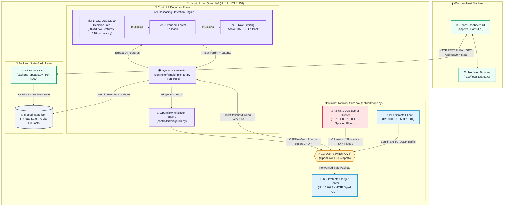
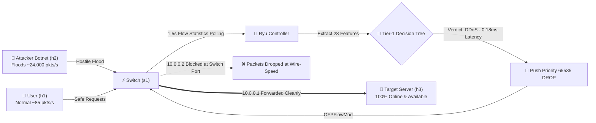

# Project-Phase-I-2026-27: SDN-Based DDoS Mitigation

> **Group ID**: 3  
> **Academic Session**: 2026-27  
> **Project Title**: Real-Time SDN-Based DDoS Detection & Mitigation System  
> **Repository**: [botvecna47/Group-ID-3_SDN-Based-DDoS-Mitigation](https://github.com/botvecna47/Group-ID-3_SDN-Based-DDoS-Mitigation)  
> **Deliverables Included**: Complete Source Code, ML Pipeline Models, Interactive UI Dashboard, Network Simulation Scripts, Documentation, and Root `requirements.txt`.

---

## SDN DDoS Mitigation Project

A production-grade Software-Defined Networking (SDN) system that detects, classifies, and mitigates Distributed Denial of Service (DDoS) attacks in real-time. Designed for academic and enterprise research, this platform combines an OpenFlow 1.3 Ryu SDN controller, a **3-Tier Cascading Machine Learning Engine** (trained on the benchmark CIC-DDoS2019 dataset), immediate OpenFlow drop-rule enforcement on Open vSwitch (OVS), and an interactive React defense dashboard.

---

## Key Highlights

- **3-Tier Cascading Defense**:
  - **Tier 1 (Production)**: 28-feature ANOVA-selected Decision Tree trained on 207,444 CIC-DDoS2019 flows (**99.98% accuracy**, **0.0% false positive rate**, **~0.18 ms latency SLA**).
  - **Tier 2 (Fallback)**: 4-feature Random Forest classifier (`detector.joblib`).
  - **Tier 3 (Failsafe)**: Deterministic rate-limiting threshold (> 10,000 PPS).
- **Multi-Vector Threat Detection**: Protects against Volumetric UDP Floods, SYN Floods, Slowloris HTTP header starvation, ICMP floods, and distributed multi-IP botnets (`10.0.0.2`–`10.0.0.8`).
- **Sub-Millisecond Wire-Speed Mitigation**: Drops malicious traffic at the switch port using `OFPFlowMod` (Priority 65535 DROP) in < 1 ms without degrading legitimate traffic.
- **Resilient IPC & Real-Time UI**: Thread-safe FileLock IPC bridge between Ryu (Eventlet) and Flask (WSGI), feeding a Vite/React dashboard with sub-millisecond metrics.
- **Automated Verification Suite**: Integrated pre-flight environmental diagnostic tool (`diagnose_environment.py`), negative failure-modes test suite (`test_failure_modes.py`), and Monte Carlo accuracy stress testing.

---

## Architecture Diagram



### Real-Time Mitigation Flow



---

## Quick Start Guide

### 1. Ubuntu Linux VM (Controller, Backend & Mininet)

Open 3 separate terminals inside the virtual environment:

```bash
# Terminal 1: Start Ryu SDN Controller with Tier 1 ML Cascade
source ryu39_env/bin/activate
ryu-manager controller/simple_monitor.py

# Terminal 2: Start Flask REST API Bridge
source ryu39_env/bin/activate
cd backend_api
python3 app.py

# Terminal 3: Clean previous OVS state & Start Mininet Topology
sudo mn -c
sudo python3 network/topo.py
```

### 2. Windows Host (Interactive Dashboard)

Open a terminal in the project root directory:

```powershell
npm install
npm run dev
```

Visit `http://localhost:5173` in your web browser. 
- **Demo Mode**: Generates synthetic telemetry for offline presentations.
- **Live Mode**: Set `VITE_DEFENSE_API_URL=http://<VM_IP>:5000/api/network-stats` in `.env` to visualize real-time OpenFlow traffic and mitigation metrics from the VM.

---

## Verification & Testing Suite

The repository includes a comprehensive, 4-tier test suite verifying environment health, failure modes, accuracy, and latency:

```bash
# 1. Pre-flight Environment & Dependency Health Audit
python3 controller/diagnose_environment.py

# 2. Failure Modes, Edge Cases & Cascade Degradation
python3 -m unittest tests/test_failure_modes.py -v

# 3. ML Inference Engine Unit Tests
python3 -m unittest tests/test_ml_engine.py -v

# 4. Statistical Accuracy & Monte Carlo Stress Testing (2,000 flows + noise)
python3 controller/test_model_accuracy.py
```

---

## Project Structure

```text
SDN-Based-DDoS-Mitigation/
├── backend_api/
│   ├── app.py                     # Flask REST API serving /api/network-stats
│   ├── state_manager.py           # Thread-safe IPC state manager using FileLock
│   └── shared_state.json          # Shared telemetry state (generated at runtime)
├── controller/
│   ├── simple_monitor.py          # Ryu OpenFlow polling & detection app
│   ├── mitigation.py              # Pushes high-priority DROP rules via OFPFlowMod
│   ├── inference_loader.py        # 3-tier cascade (CIC-DDoS2019 -> RF -> Threshold)
│   ├── diagnose_environment.py    # Pre-flight environment & socket readiness auditor
│   ├── test_model_accuracy.py     # Monte Carlo & noise robustness benchmark
│   ├── test_ml_integration.py     # Live benign vs attack verification
│   └── comprehensive_uat_verify.py# Full UAT verification script
├── ml_pipeline/
│   ├── exported_models/           # Pre-trained models, scalers & feature selectors
│   │   ├── best_sdn_model.joblib  # Tier-1 CIC-DDoS2019 Decision Tree
│   │   ├── scaler.joblib          # Feature StandardScaler
│   │   ├── anova_selector.joblib  # Top-28 ANOVA Feature Selector
│   │   ├── decision_tree.joblib   # Serialized decision tree artifact
│   │   ├── random_forest.joblib   # Random Forest baseline model
│   │   ├── xgboost.joblib         # XGBoost baseline model
│   │   └── lstm_ddos_model.keras  # Deep Learning LSTM model
│   ├── data_preprocessing.py      # CIC-DDoS2019 cleaning & normalization
│   ├── pipeline.py                # Model training, evaluation & metrics logging
│   └── test_overfitting.py        # K-fold cross-validation & generalization check
├── network/
│   ├── topo.py                    # Standard Mininet topology script (h1, h2, h3, s1)
│   ├── topo_botnet.py             # 8-Host distributed botnet topology (h1, h2/h4-h8, h3)
│   ├── attack_menu.sh             # Interactive attack launcher (6 attack vectors)
│   ├── slowloris.py               # Lightweight Slowloris HTTP header starvation script
│   └── *.sh                       # Traffic generation scripts (hping3, iperf, legit)
├── tests/
│   ├── test_ml_engine.py          # Unit tests for ML inference engine & SLAs
│   └── test_failure_modes.py      # Negative testing, lock contention & schema validation
├── docs/                          # Architecture, PRD, SRS, and evaluation reports
│   ├── ATTACK_EMULATION_GUIDE.md  # Multi-vector DDoS attack execution & emulation guide
│   ├── SDN_DDOS_PIPELINE_REPORT.md# Complete ML pipeline evaluation & academic benchmark
│   ├── presentation/              # 15-Slide academic presentation & PowerPoint (.pptx)
│   └── visualizations/            # 300 DPI ROC/PR curves, confusion matrices & tree rules
├── src/                           # React frontend source code (App.tsx, data.ts)
├── RUNNING_GUIDE.md               # Detailed step-by-step launch & troubleshooting guide
└── README.md                      # This file
```

---

## Machine Learning Pipeline & Performance

The detection engine was trained and benchmarked across 5 architectures using 207,444 flows from the **CIC-DDoS2019** dataset:

| Model Architecture | Accuracy | Precision | Recall | F1-Score | Inference Latency | Status in SDN |
|:---|:---:|:---:|:---:|:---:|:---:|:---|
| **Decision Tree (ANOVA-28)** | **99.98%** | **99.97%** | **100.0%** | **0.9998** | **0.18 ms** | **Tier 1 (Active)** |
| **Random Forest (100 Trees)**| 99.99% | 99.99% | 100.0% | 0.9999 | 1.84 ms | Tier 2 (Fallback) |
| **XGBoost (Histogram)** | 99.98% | 99.98% | 100.0% | 0.9998 | 2.12 ms | Benchmarked |
| **LSTM Recurrent Net** | 99.74% | 99.70% | 99.92% | 0.9981 | 14.80 ms | Exceeds 5ms SLA |
| **Logistic Regression** | 94.67% | 94.10% | 96.80% | 0.9543 | 0.12 ms | Low Non-Linearity |

Full evaluation figures, ROC/PR curves, and confusion matrices are located in [docs/visualizations/](docs/visualizations/) and documented in [docs/SDN_DDOS_PIPELINE_REPORT.md](docs/SDN_DDOS_PIPELINE_REPORT.md).

---

## Documentation Index

| Document | Description |
|:---|:---|
| [Running Guide](RUNNING_GUIDE.md) | Step-by-step startup order, VM network setup, and troubleshooting commands. |
| [Attack Emulation Guide](docs/ATTACK_EMULATION_GUIDE.md) | How to emulate 6 attack vectors (Volumetric UDP, SYN, Slowloris, ICMP, Botnet). |
| [ML Pipeline Report](docs/SDN_DDOS_PIPELINE_REPORT.md) | Detailed academic report on CIC-DDoS2019 feature engineering and model training. |
| [Presentation Slides](docs/presentation/PRESENTATION_SLIDES_15.md) | 15-slide technical presentation deck with speaker notes and UML diagrams. |
| [Architecture](docs/ARCHITECTURE.md) | In-depth breakdown of system components, threading, and data flow. |
| [API Schema](docs/API_SCHEMA.md) | Contract for Flask REST API endpoints and TypeScript data models. |
| [Demo Script](docs/DEMO_SCRIPT.md) | Presentation runbook for demonstrating live attacks and instant mitigation. |

---

## Current Status

- **Implemented & Fully Operational**:
  - Mininet network topology with multi-IP botnet support (`h1` client, `h2`–`h8` attackers, `h3` server).
  - OpenFlow 1.3 Ryu controller polling flow statistics every 1.5 seconds.
  - **Tier-1 CIC-DDoS2019 Decision Tree integration** with sub-millisecond inference (`~0.18 ms`).
  - Automated 3-tier cascade fallback mechanism (ML $\to$ Random Forest $\to$ Rate Limiting).
  - Instant wire-speed drop rule installation via `OFPFlowMod` (Priority 65535).
  - Thread-safe FileLock IPC bridge syncing Ryu controller state with Flask REST API.
  - Interactive React dashboard with live/demo toggle and real-time sub-millisecond metrics.
  - Complete automated testing suite (unit tests, failure modes, accuracy, pre-flight diagnostics).
  - Full academic documentation, 15-slide presentation deck, and 300 DPI visualizations.

*Last Updated: 2026-11-16*
