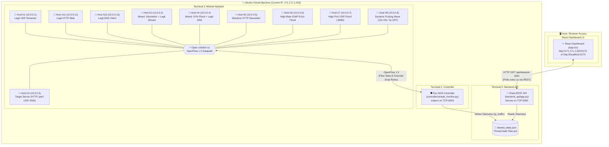
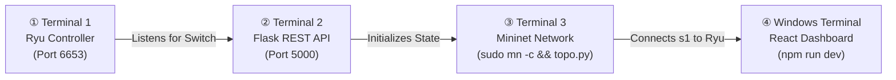
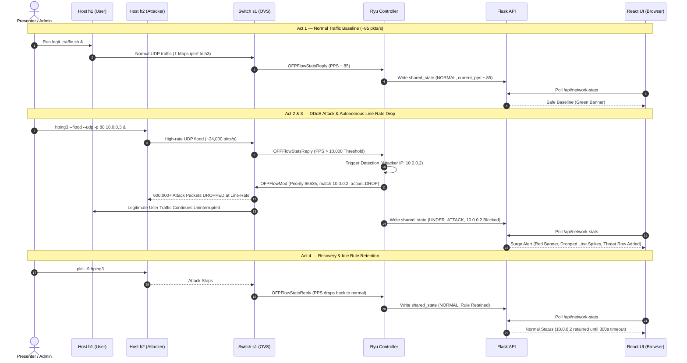

# 🛡️ SDN DDoS Mitigation — Setup & Running Guide

> **Last updated: 2026-11-18**
> The root `src/` dashboard starts in Demo mode; switch to Live after the API and Mininet switch are reporting.
> **Current VM IP: `10.1.250.237`** (verify anytime with `hostname -I`).
> *Note: The React dashboard automatically detects your current host IP (`window.location.hostname`), so no manual IP editing is needed.*
> **Always `git pull` on Ubuntu before starting a session.**

---

## 🗺️ Architecture — What Runs Where



```
Ubuntu VM (171.171.1.253)                  Browser / Client Machine
┌─────────────────────────────┐           ┌──────────────────────────┐
│ Terminal 1: Ryu Controller  │           │ React Dashboard UI       │
│ → port 6653 (OpenFlow)      │           │ → http://171.171.1.253:5173
│                             │           │                          │
│ Terminal 2: Flask API       │◄──HTTP────│ Polls /api/network-stats │
│ → port 5000 (REST)          │           │ every 1 second           │
│                             │           └──────────────────────────┘
│ Terminal 3: Mininet         │
│ → h1-h12, h2-h8, h3, s1     │
└─────────────────────────────┘
```

| Component | Machine | Port | File |
|-----------|---------|------|------|
| Ryu SDN Controller | Ubuntu VM | 6653 | `controller/simple_monitor.py` |
| Flask REST API | Ubuntu VM | 5000 | `backend_api/app.py` |
| Botnet Topology (10 Hosts) | Ubuntu VM | — | `network/topo_botnet.py` |
| Basic Demo Topology (3 Hosts)| Ubuntu VM | — | `network/topo.py` |
| Interactive Attack Menu | Ubuntu VM | — | `network/attack_menu.sh` |
| Dynamic Traffic Suite | Ubuntu VM | — | `network/dynamic_traffic_suite.py` |
| React Dashboard | Any Browser | 5173 | `src/App.tsx` |

---

## ⚠️ The Three Rules — Read Every Time

> [!IMPORTANT]
> **Rule 1 — Order always matters:** Ryu → Flask → Mininet → React.
> Never start Mininet before Ryu. The switch connects to the controller on startup. If Ryu is not running, the switch has no controller and drops all packets.



> [!IMPORTANT]
> **Rule 2 — Always clean before Mininet:** Run `sudo mn -c` before every `sudo python3 network/topo.py`.
> Leftover OVS state from previous sessions causes silent failures and 100% packet loss.

> [!IMPORTANT]
> **Rule 3 — Always activate the virtualenv:** Run `source ryu39_env/bin/activate` in every Ubuntu terminal before running Ryu or Flask.

---

## 🔧 One-Time Setup (First Time Only)

Only do this once after cloning the repo. Skip this section on every subsequent session.

### On Ubuntu VM

```bash
# 1. Install system dependencies
sudo apt update
sudo apt install -y mininet openvswitch-switch hping3 iperf xterm git python3.9 python3.9-venv python3.9-distutils

# 2. Clone the project
git clone https://github.com/botvecna47/SDN-Based-DDoS-Mitigation.git
cd SDN-Based-DDoS-Mitigation

# 3. Create Python 3.9 virtual environment
#    Ryu does NOT work on Python 3.10+. Must use 3.9.
python3.9 -m venv ryu39_env
source ryu39_env/bin/activate

# 4. Install the Ryu compatibility pins, then the application dependencies
pip install setuptools==59.6.0 wheel==0.37.1
pip install eventlet==0.30.2
pip install ryu flask flask-cors pandas scikit-learn filelock joblib

# 5. Verify installation
ryu-manager --version     # Should print: ryu 4.x
python3 -c "import flask; print('Flask OK')"
python3 -c "import filelock; print('Filelock OK')"
```

### On Windows

```bash
# In the project folder (where package.json is)
npm install
```

#### 🔌 Setting Your IP Address (For Teammates)
If your teammate is running this on their own machine, their Ubuntu VM will have a different IP address. 
They DO NOT need to edit the source code. Instead:
1. Copy the `.env.example` file and rename it to `.env`
2. Run `hostname -I` in their Ubuntu VM to get their IP (currently `171.171.1.253`).
3. Edit the `.env` file and set their IP:
   `VITE_DEFENSE_API_URL="http://171.171.1.253:5000/api/network-stats"`

---

## 🚀 Every-Session Launch Sequence

Open **4 terminals** (3 on Ubuntu, 1 on Windows or browser).

---

### ① Ubuntu Terminal 1 — Ryu Controller

```bash
cd SDN-Based-DDoS-Mitigation
git pull                                        # Always pull latest before starting
source ryu39_env/bin/activate
ryu-manager controller/simple_monitor.py
```

**✅ Success looks like:**
```
loading app controller/simple_monitor.py
instantiating app controller/simple_monitor.py of SimpleMonitor13
[DDoSDetector] Tier 1 Active: CIC-DDoS2019 Decision Tree (99.99% Acc, ANOVA)
Registering datapath: 0000000000000001
```

**🛑 DO NOT continue until you see Ryu is running and registers datapath.**

---

### ② Ubuntu Terminal 2 — Flask API

Open a new Ubuntu terminal tab:

```bash
cd SDN-Based-DDoS-Mitigation
source ryu39_env/bin/activate
cd backend_api
python3 app.py
```

**✅ Success looks like:**
```
* Running on http://0.0.0.0:5000
* Running on http://171.171.1.253:5000
```

**Quick test** (from any machine on the network):
```bash
curl http://171.171.1.253:5000/api/health
# Should return: {"status": "ok", "timestamp": "..."}
```

**🛑 DO NOT continue until Flask is serving on port 5000.**

---

### ③ Ubuntu Terminal 3 — Mininet Network (Botnet or 3-Host Demo)

Choose between the **10-Host Botnet Topology** (recommended for multi-IP and mixed traffic demonstration) or the **3-Host Classic Topology**:

#### Option A: 10-Host Botnet Topology (Full Capability & Hands-Free Attack)
```bash
# Clean previous state (mandatory)
sudo mn -c

# Method 1: Boot network AND immediately start all 6 attack vectors (Recommended):
sudo python3 network/topo_botnet.py --attack

# Method 2: Boot network into interactive CLI:
sudo python3 network/topo_botnet.py
```

When started with `--attack`, Mininet boots in < 1 second, launches the multi-threaded HTTP/UDP target server `h3`, initializes legitimate background users (`h1`, `h11`, `h12`), and automatically unleashes the 6 distinct DDoS attack vectors with same-IP mixed traffic on `h2` and `h4`.

Inside the interactive `mininet-botnet>` CLI (if running Method 2), you can run custom commands:
```text
botnet> botnet       # Launches all attackers with distinct rates & mixed traffic
botnet> legit        # Spawns baseline legitimate user traffic (~1,315 pkts/s)
botnet> stop_attack  # Halts attacks; retains legitimate traffic
botnet> stop_all     # Stops all traffic generators
botnet> status       # Shows active background generator processes
```

#### Option B: 3-Host Classic Demo Topology
```bash
sudo mn -c
sudo python3 network/topo.py
```

**✅ Success looks like (in order):**
```
*** Creating network, connecting to controller at 127.0.0.1
*** Starting iperf UDP server on h3
*** Bootstrapping MAC learning with pingall
h1 -> h2 h3
h2 -> h1 h3
h3 -> h1 h2
*** Results: 0% dropped
*** MAC learning complete. Network is ready.
mininet>
```

> [!NOTE]
> The `pingall` runs automatically. You do NOT need to type it manually anymore.
> If you see `100% dropped` in the pingall output, stop immediately and restart from Step ①.

**Simultaneously check Terminal 1 (Ryu) — you MUST see:**
```
Registering datapath: 0000000000000001
```
If this line does not appear, the switch is not connected to Ryu. Restart from Step ①.

---

### ④ Windows Terminal — React Dashboard

```bash
# In the project root (where package.json is)
npm run dev
```

Open your browser at: **http://localhost:5173**

**The dashboard opens in Demo mode** so it is presentation-ready before the VM is connected. Select **Live** after Flask and the Mininet switch are running. Set `VITE_DEFENSE_API_URL` in `.env` to your VM's reachable IP before starting Vite; restart Vite after changing `.env`.

> [!TIP]
> If Live mode reports no recent switch statistics, verify Ryu registered the datapath and Mininet `pingall` succeeds. The dashboard reports telemetry as offline until fresh switch stats arrive.

---

## 🎯 Interactive Attack Emulation Launchpad (`network/attack_menu.sh`)

The system includes a unified interactive attack emulation suite that can be launched in a dedicated terminal or directly from within Mininet:

```bash
# Launch interactive menu (as root or inside Mininet)
sudo bash network/attack_menu.sh
```

You can also pass non-interactive arguments directly (e.g. `sudo bash network/attack_menu.sh 6` or `mininet> h2 bash network/attack_menu.sh botnet`).

### Attack Menu Options Overview

```text
======================================================================
       SDN DDOS MITIGATION — ATTACK EMULATION LAUNCHPAD               
======================================================================
 Target Server : 10.0.0.3 (Host h3)
 Detection     : Tier-1 CIC-DDoS2019 Decision Tree (Ryu Controller)
 Granularity   : Flow-Tuple Mitigation (Same-IP Mixed Allowed + Dropped)
======================================================================

Select an emulation vector to launch:
  [1]  Volumetric UDP Flood       (h2: 10.0.0.2 :80 @ ~9,500 PPS)
  [2]  TCP SYN Handshake Flood    (h4: 10.0.0.4 :80 @ ~6,800 PPS)
  [3]  Slowloris HTTP Starvation  (h5: 10.0.0.5 :80 @ ~45 PPS)
  [4]  High-Rate ICMP Ping Flood  (h6: 10.0.0.6 @ ~5,200 PPS)
  [5]  Dynamic Pulsing Wave DDoS  (h8: 10.0.0.8 10s ON ~7,600 PPS / 5s OFF)
  [6]  Coordinated Botnet Assault (Launches h2, h4-h8 with distinct rates)
  [7]  Same-IP Mixed Traffic Demo (h2 and h4 simultaneous legit + attack)
  [8]  High-Port UDP Flood        (h7: 10.0.0.7 :8080 @ ~11,400 PPS)
  [9]  Start Legitimate Streams   (h1, h11, h12 baseline ~1,315 PPS)
  [10] Stop Attack Traffic        (Halts attacks; retains legitimate streams)
  [11] Stop All Traffic           (Halts attacks AND legitimate traffic)
  [0]  Exit
```

### Detailed Attack Vector Characteristics

| Option | Name | Source IP | Port / Protocol | Packet Rate | Behavior & Defense Action |
|--------|------|-----------|-----------------|-------------|---------------------------|
| **1** | Volumetric UDP Flood | `10.0.0.2` | UDP :80 | ~9,500 pkts/s | Line-rate switch drop; Priority 65535 DROP rule installed. |
| **2** | TCP SYN Flood | `10.0.0.4` | TCP SYN :80 | ~6,800 pkts/s | Incomplete handshake flood; detected and dropped at line-rate. |
| **3** | Slowloris HTTP Starvation | `10.0.0.5` | TCP :80 | ~45 pkts/s | Low-and-slow socket exhaustion; detected by low BPS / persistent sockets. |
| **4** | ICMP Echo Flood | `10.0.0.6` | ICMP (proto 1) | ~5,200 pkts/s | High-rate echo ping saturation; isolated without blackholing ping service. |
| **5** | Pulsing Wave DDoS | `10.0.0.8` | UDP :53 | 10s ON (~7,600) / 5s OFF (0) | Wave attack designed to game static thresholds; caught by ML detector. |
| **6** | Coordinated Botnet | `10.0.0.2`–`10.0.0.8` | Mixed ports | ~40,500 pkts/s total | Multi-vector attack with distinct rates per IP and concurrent legit streams. |
| **7** | Same-IP Mixed Traffic | `10.0.0.2`, `10.0.0.4` | UDP/TCP | ~16,300 pkts/s | Proves flow-level granularity: legit stream passes, attack dropped from same IP. |
| **8** | High-Port UDP Flood | `10.0.0.7` | UDP :8080 | ~11,400 pkts/s | Amplification flood simulation on high service port. |
| **9** | Legitimate Streams | `10.0.0.1`, `11`, `12` | :5001, :80, :53 | ~1,315 pkts/s total | Baseline safe traffic passing through Priority 10 FORWARD rules. |

### Running the Python Dynamic Traffic Generator Directly
```bash
# Botnet mode with mixed traffic and pulsing wave
sudo python3 network/dynamic_traffic_suite.py --mode botnet

# Same-IP mixed traffic mode
sudo python3 network/dynamic_traffic_suite.py --mode mixed_same_ip

# Pure legitimate traffic baseline
sudo python3 network/dynamic_traffic_suite.py --mode legit_only
```

---



### Act 1 — Baseline: Normal Traffic

At the Mininet `mininet>` prompt:
```
mininet> h1 bash network/legit_traffic.sh &
```

**What you see on dashboard:**
- 🔵 Blue line rises to ~0.8k PPS on the chart
- Health banner: **"Network Operating Normally"** (green)
- Live rate and active flow rules update from switch counters; the API does not report a cumulative TB total.

This is the legitimate user (h1) sending normal UDP traffic to the server (h3). The blue line is below the red threshold line — all traffic is being **allowed**.

---

### Act 2 — DDoS Attack Launched

At the Mininet `mininet>` prompt, launch the flood in the background:
```text
mininet> h2 hping3 --flood --udp -p 80 10.0.0.3 &
```
*(Tip: You do not need `sudo` inside Mininet as the Mininet process already runs with root capabilities. If you prefer a separate graphical window, you can run `mininet> xterm h2` and execute `hping3 --flood --udp -p 80 10.0.0.3`).*

**What you see on dashboard (after Ryu receives flow statistics within 1.5s):**
- 📈 Total Incoming line spikes dramatically above the orange threshold line (~24k pkts/s)
- Top banner turns red: **"DDoS Attack Detected · Autonomous Mitigation Active"**
- Ryu logs in Terminal 1: `DDoS Detected from 10.0.0.2! Pushing drop rule...`

---

### Act 3 — Autonomous Mitigation

Without any manual administrator action:
- Ryu installs a **Priority 65535 DROP rule** for `10.0.0.2` on switch `s1`
- 🔴 The red **Blocked Traffic** line rises on the chart to intercept the attack
- 🟢 The green **Clean Forwarded** line stays flat at ~85 pkts/s — legitimate user `h1` traffic **continues uninterrupted**!
- `10.0.0.2` appears in the **Blocked Devices & Security Events** table with active drop status
- The **Detection Trigger Breakdown** panel identifies the active classifier or threshold fallback

To verify the DROP rule directly on the switch:
```text
mininet> sh ovs-ofctl dump-flows s1 -O OpenFlow13
```
You should see: `priority=65535,ip,nw_src=10.0.0.2 actions=drop` with thousands of dropped packets accumulating!

---

### Act 4 — Recovery & Rule Retention

At the Mininet `mininet>` prompt, stop the attack flood:
```text
mininet> h2 pkill -9 hping3
```
*(Or press `Ctrl+C` if running inside `xterm h2`).*

**What you see on dashboard:**
- Total incoming line drops back to the clean baseline (~85 pkts/s)
- Status returns to normal operational mode (green banner)
- `10.0.0.2` remains listed in the Blocked Devices table with an amber **`RULE RETAINED`** badge until the OpenFlow idle-timeout (300 seconds) expires without matching traffic.

---

### Flow Table (for inspection/demo)

At any point you can see a human-readable breakdown of every OpenFlow rule:
```bash
curl http://171.171.1.253:5000/api/flow-table
```

This returns:
- **ALLOWED flows** — which IPs/ports are being forwarded and why
- **BLOCKED flows** — which IPs/ports have DROP rules and why
- **Table-miss rule** — how unknown flows are handled (sent to controller for MAC learning)

---

## 🛑 Clean Shutdown

```bash
# 1. Stop attacks — Option [10] in attack_menu.sh or Ctrl+C
# 2. Stop all traffic — Option [11] in attack_menu.sh
# 3. Exit Mininet
mininet> exit
# or in botnet topology
botnet> exit

# 4. Clean OVS state
sudo mn -c

# 5. Ctrl+C in Terminal 2 (Flask)
# 6. Ctrl+C in Terminal 1 (Ryu)
# 7. Ctrl+C in Dashboard terminal (React)
```

---

## 🔧 Troubleshooting

| Symptom | Cause | Fix |
|---------|-------|-----|
| Mininet `pingall` shows 100% dropped | Ryu not running or wrong controller IP | Run `sudo mn -c`, restart Ryu first |
| Dashboard cannot load telemetry | Flask not running or VM IP wrong | Check `python3 app.py` is running and set `VITE_DEFENSE_API_URL` in `.env`; restart Vite after changing it |
| Chart stays flat at 0 PPS | MAC learning not bootstrapped | `pingall` now runs automatically on startup — if still 0, restart from Step ① |
| `ryu-manager: command not found` | Virtualenv not active | `source ryu39_env/bin/activate` |
| `ModuleNotFoundError: ryu` | Wrong Python version or wrong venv | Must use Python 3.9 venv: `python3.9 -m venv ryu39_env` |
| `AttributeError: collections.MutableMapping` | Python 3.10+ used for Ryu | Recreate venv with `python3.9 -m venv ryu39_env` |
| `ImportError: cannot import ALREADY_HANDLED` | eventlet version too new | `pip install eventlet==0.30.2` |
| `ModuleNotFoundError: filelock` | Missing dependency | `pip install filelock` inside activated venv |
| `get_script_args` error on `pip install ryu` | setuptools too new | `pip install setuptools==59.6.0 wheel==0.37.1` first |
| Attack not detected (no DROP rule) | Switch connection, traffic rate, or model result | Check Ryu registered the switch, inspect `ovs-ofctl dump-flows s1`, and confirm the attack source exceeds benign thresholds |
| Blocked row disappears unexpectedly | Switch flow removal event or controller restart | The controller now removes a blocked row when OVS reports rule removal; a controller restart clears its in-memory block list |
| `xterm h2` window does not open | No display in VM | Use the interactive attack menu directly: `sudo bash network/attack_menu.sh` |

---

## 📡 Network & Config Reference

### Mininet Hosts (Botnet Topology)
| Host | IP | MAC | Role | Traffic Profiles |
|------|----|-----|------|------------------|
| h1 | `10.0.0.1` | `00:00:00:00:00:01` | Pure Legit Client | UDP stream :5001 (~820 pkts/s) |
| h11 | `10.0.0.11` | `00:00:00:00:00:0b` | Pure Legit Client | HTTP web :80 (~310 pkts/s) |
| h12 | `10.0.0.12` | `00:00:00:00:00:0c` | Pure Legit Client | DNS queries :53 (~185 pkts/s) |
| h2 | `10.0.0.2` | `00:00:00:00:00:02` | Mixed Node | Volumetric UDP flood :80 (~9.5k PPS) + Legit :5001 (~440 PPS) |
| h4 | `10.0.0.4` | `00:00:00:00:00:04` | Mixed Node | TCP SYN flood :80 (~6.8k PPS) + Legit DNS :53 (~230 PPS) |
| h5 | `10.0.0.5` | `00:00:00:00:00:05` | Attacker | Slowloris HTTP starvation :80 (~45 PPS) |
| h6 | `10.0.0.6` | `00:00:00:00:00:06` | Attacker | High-Rate ICMP Echo Flood (~5.2k PPS) |
| h7 | `10.0.0.7` | `00:00:00:00:00:07` | Attacker | High-Port UDP Flood :8080 (~11.4k PPS) |
| h8 | `10.0.0.8` | `00:00:00:00:00:08` | Attacker | Pulsing Wave DDoS (10s ON ~7.6k PPS / 5s OFF 0 PPS on :53) |
| h3 | `10.0.0.3` | `00:00:00:00:00:03` | Protected Server | HTTP (:80, :8080), iperf UDP (:5001), DNS (:53) |
| s1 | — | — | OVS Switch | OpenFlow 1.3 Datapath |

### Service Addresses
| Service | Address | Notes |
|---------|---------|-------|
| Ryu Controller | `127.0.0.1:6653` | Listens for OVS switch connections |
| Flask API | `0.0.0.0:5000` | Accessible at `http://171.171.1.253:5000` |
| React Dashboard | `http://171.171.1.253:5173` | Accessible from browser on VM or LAN |
| Ubuntu VM | `171.171.1.253` | Current VMware VM IP (verify with `hostname -I`) |

### Key API Endpoints
| Endpoint | What it returns |
|----------|----------------|
| `GET /api/network-stats` | Full telemetry snapshot for dashboard (ipTraffic, exact sums, metrics) |
| `GET /api/health` | Simple liveness check |
| `GET /api/flow-table` | Human-readable ALLOWED vs BLOCKED flow breakdown |

---

## 📋 Quick Command Reference

```bash
# Ubuntu — activate virtualenv (run this in every terminal before Ryu or Flask)
source ryu39_env/bin/activate

# Ubuntu — pull latest code
git pull

# Ubuntu — clean leftover Mininet state (run before every topo)
sudo mn -c

# Ubuntu — start Ryu controller
ryu-manager controller/simple_monitor.py

# Ubuntu — start Flask API (from inside backend_api/)
cd backend_api && python3 app.py

# Ubuntu — start Botnet Mininet Topology (10 hosts)
sudo python3 network/topo_botnet.py

# Ubuntu — launch Interactive Attack Menu
sudo bash network/attack_menu.sh

# Ubuntu — launch Dynamic Traffic Generation Suite directly
sudo python3 network/dynamic_traffic_suite.py --mode botnet

# Run Comprehensive ML Model Accuracy & Health Audit
python3 controller/test_model_accuracy.py

# Run Automated Unit Test Suite (24 tests)
python3 -m unittest discover tests -v

# Any machine — query telemetry API
curl http://171.171.1.253:5000/api/network-stats
curl http://171.171.1.253:5000/api/flow-table

# Start React dashboard
npm run dev
```
