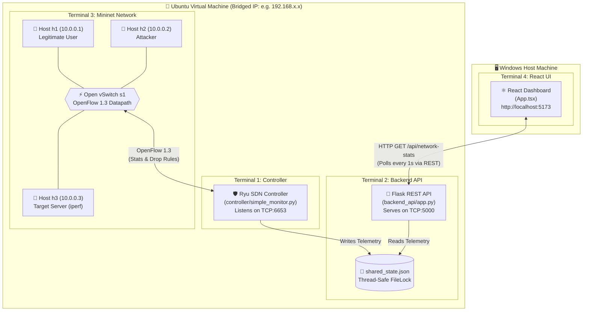
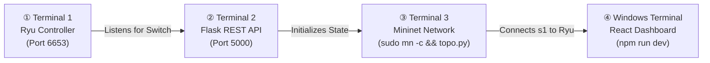
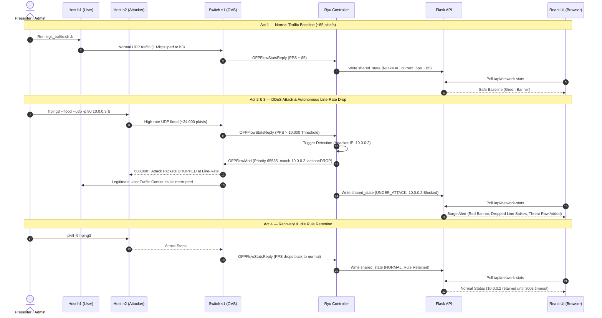

# 🛡️ SDN DDoS Mitigation — Setup & Running Guide

> **Last updated: 2026-10-28**
> The root `src/` dashboard starts in Demo mode; switch to Live after the API and Mininet switch are reporting.
> **Always `git pull` on Ubuntu before starting a session.**

---

## 🗺️ Architecture — What Runs Where



```
Ubuntu VM (192.168.x.x)                    Windows Machine
┌─────────────────────────────┐           ┌──────────────────────────┐
│ Terminal 1: Ryu Controller  │           │ Terminal: React Dashboard │
│ → port 6653 (OpenFlow)      │           │ → http://localhost:5173   │
│                             │           │                          │
│ Terminal 2: Flask API       │◄──HTTP────│ Polls /api/network-stats │
│ → port 5000 (REST)          │           │ every 1 second           │
│                             │           └──────────────────────────┘
│ Terminal 3: Mininet         │
│ → h1, h2, h3, s1           │
└─────────────────────────────┘
```

| Component | Machine | Port | File |
|-----------|---------|------|------|
| Ryu SDN Controller | Ubuntu VM | 6653 | `controller/simple_monitor.py` |
| Flask REST API | Ubuntu VM | 5000 | `backend_api/app.py` |
| Mininet Topology | Ubuntu VM | — | `network/topo.py` |
| React Dashboard | Windows | 5173 | `src/App.tsx` |

---

## ⚠️ The Three Rules — Read Every Time

> [!IMPORTANT]
> **Rule 1 — Order always matters:** Ryu → Flask → Mininet → React.
> Never start Mininet before Ryu. The switch connects to the controller on startup. If Ryu is not running, the switch has no controller and drops all packets.



> [!IMPORTANT]
> **Rule 2 — Always clean before Mininet:** Run `sudo mn -c` before every `sudo python3 network/topo.py`.
> Leftover OVS state from previous sessions causes silent failures and 100% packet loss.

> [!IMPORTANT]
> **Rule 3 — Always activate the virtualenv:** Run `source ryu39_env/bin/activate` in every Ubuntu terminal before running Ryu or Flask.

---

## 🔧 One-Time Setup (First Time Only)

Only do this once after cloning the repo. Skip this section on every subsequent session.

### On Ubuntu VM

```bash
# 1. Install system dependencies
sudo apt update
sudo apt install -y mininet openvswitch-switch hping3 iperf xterm git python3.9 python3.9-venv python3.9-distutils

# 2. Clone the project
git clone https://github.com/botvecna47/SDN-Based-DDoS-Mitigation.git
cd SDN-Based-DDoS-Mitigation

# 3. Create Python 3.9 virtual environment
#    Ryu does NOT work on Python 3.10+. Must use 3.9.
python3.9 -m venv ryu39_env
source ryu39_env/bin/activate

# 4. Install the Ryu compatibility pins, then the application dependencies
pip install setuptools==59.6.0 wheel==0.37.1
pip install eventlet==0.30.2
pip install ryu flask flask-cors pandas scikit-learn filelock joblib

# 5. Verify installation
ryu-manager --version     # Should print: ryu 4.x
python3 -c "import flask; print('Flask OK')"
python3 -c "import filelock; print('Filelock OK')"
```

### On Windows

```bash
# In the project folder (where package.json is)
npm install
```

#### 🔌 Setting Your IP Address (For Teammates)
If your teammate is running this on their own machine, their Ubuntu VM will have a different IP address. 
They DO NOT need to edit the source code. Instead:
1. Copy the `.env.example` file and rename it to `.env`
2. Run `hostname -I` in their Ubuntu VM to get their IP.
3. Edit the `.env` file and replace `192.168.8.147` with their IP:
   `VITE_DEFENSE_API_URL="http://YOUR_VM_IP:5000/api/network-stats"`

---

## 🚀 Every-Session Launch Sequence

Open **4 terminals** (3 on Ubuntu, 1 on Windows).

---

### ① Ubuntu Terminal 1 — Ryu Controller

```bash
cd SDN-Based-DDoS-Mitigation
git pull                                        # Always pull latest before starting
source ryu39_env/bin/activate
ryu-manager controller/simple_monitor.py
```

**✅ Success looks like:**
```
loading app controller/simple_monitor.py
instantiating app controller/simple_monitor.py of SimpleMonitor13
Ryu is running
```

**Active ML Model Notice:**
```
[DDoSDetector] Tier 1 Active: CIC-DDoS2019 Decision Tree (99.99% Acc, ANOVA)
```

**🛑 DO NOT continue until you see Ryu is running.**

---

### ② Ubuntu Terminal 2 — Flask API

Open a new Ubuntu terminal tab:

```bash
cd SDN-Based-DDoS-Mitigation
source ryu39_env/bin/activate
cd backend_api
python3 app.py
```

**✅ Success looks like:**
```
* Running on http://0.0.0.0:5000
* Running on http://192.168.8.147:5000
```

**Quick test** (from any machine on the network):
```bash
curl http://192.168.8.147:5000/api/health
# Should return: {"status": "ok", "timestamp": "..."}
```

**🛑 DO NOT continue until Flask is serving on port 5000.**

---

### ③ Ubuntu Terminal 3 — Mininet Network

Open a new Ubuntu terminal tab:

```bash
# Step A: Clean any leftover state first (mandatory)
sudo mn -c

# Step B: Start the network
cd SDN-Based-DDoS-Mitigation
sudo python3 network/topo.py
```

**✅ Success looks like (in order):**
```
*** Creating network, connecting to controller at 127.0.0.1
*** Starting iperf UDP server on h3
*** Bootstrapping MAC learning with pingall
h1 -> h2 h3
h2 -> h1 h3
h3 -> h1 h2
*** Results: 0% dropped
*** MAC learning complete. Network is ready.
mininet>
```

> [!NOTE]
> The `pingall` runs automatically. You do NOT need to type it manually anymore.
> If you see `100% dropped` in the pingall output, stop immediately and restart from Step ①.

**Simultaneously check Terminal 1 (Ryu) — you MUST see:**
```
Registering datapath: 0000000000000001
```
If this line does not appear, the switch is not connected to Ryu. Restart from Step ①.

---

### ④ Windows Terminal — React Dashboard

```bash
# In the project root (where package.json is)
npm run dev
```

Open your browser at: **http://localhost:5173**

**The dashboard opens in Demo mode** so it is presentation-ready before the VM is connected. Select **Live** after Flask and the Mininet switch are running. Set `VITE_DEFENSE_API_URL` in `.env` to your VM's reachable IP before starting Vite; restart Vite after changing `.env`.

> [!TIP]
> If Live mode reports no recent switch statistics, verify Ryu registered the datapath and Mininet `pingall` succeeds. The dashboard reports telemetry as offline until fresh switch stats arrive.

---

## 🎬 Demo Walkthrough



### Act 1 — Baseline: Normal Traffic

At the Mininet `mininet>` prompt:
```
mininet> h1 bash network/legit_traffic.sh &
```

**What you see on dashboard:**
- 🔵 Blue line rises to ~0.8k PPS on the chart
- Health banner: **"Network Operating Normally"** (green)
- Live rate and active flow rules update from switch counters; the API does not report a cumulative TB total.

This is the legitimate user (h1) sending normal UDP traffic to the server (h3). The blue line is below the red threshold line — all traffic is being **allowed**.

---

### Act 2 — DDoS Attack Launched

At the Mininet `mininet>` prompt, launch the flood in the background:
```text
mininet> h2 hping3 --flood --udp -p 80 10.0.0.3 &
```
*(Tip: You do not need `sudo` inside Mininet as the Mininet process already runs with root capabilities. If you prefer a separate graphical window, you can run `mininet> xterm h2` and execute `hping3 --flood --udp -p 80 10.0.0.3`).*

**What you see on dashboard (after Ryu receives flow statistics within 1.5s):**
- 📈 Total Incoming line spikes dramatically above the orange threshold line (~24k pkts/s)
- Top banner turns red: **"DDoS Attack Detected · Autonomous Mitigation Active"**
- Ryu logs in Terminal 1: `DDoS Detected from 10.0.0.2! Pushing drop rule...`

---

### Act 3 — Autonomous Mitigation

Without any manual administrator action:
- Ryu installs a **Priority 65535 DROP rule** for `10.0.0.2` on switch `s1`
- 🔴 The red **Blocked Traffic** line rises on the chart to intercept the attack
- 🟢 The green **Clean Forwarded** line stays flat at ~85 pkts/s — legitimate user `h1` traffic **continues uninterrupted**!
- `10.0.0.2` appears in the **Blocked Devices & Security Events** table with active drop status
- The **Detection Trigger Breakdown** panel identifies the active classifier or threshold fallback

To verify the DROP rule directly on the switch:
```text
mininet> sh ovs-ofctl dump-flows s1 -O OpenFlow13
```
You should see: `priority=65535,ip,nw_src=10.0.0.2 actions=drop` with thousands of dropped packets accumulating!

---

### Act 4 — Recovery & Rule Retention

At the Mininet `mininet>` prompt, stop the attack flood:
```text
mininet> h2 pkill -9 hping3
```
*(Or press `Ctrl+C` if running inside `xterm h2`).*

**What you see on dashboard:**
- Total incoming line drops back to the clean baseline (~85 pkts/s)
- Status returns to normal operational mode (green banner)
- `10.0.0.2` remains listed in the Blocked Devices table with an amber **`RULE RETAINED`** badge until the OpenFlow idle-timeout (300 seconds) expires without matching traffic.

---

### Flow Table (for inspection/demo)

At any point you can see a human-readable breakdown of every OpenFlow rule:
```bash
curl http://192.168.8.147:5000/api/flow-table
```

This returns:
- **ALLOWED flows** — which IPs are being forwarded and why
- **BLOCKED flows** — which IPs have DROP rules and why
- **Table-miss rule** — how unknown flows are handled (sent to controller for MAC learning)

---

## 🛑 Clean Shutdown

```bash
# 1. Stop attack (if running) — Ctrl+C in xterm h2
# 2. Stop legitimate traffic and its current iperf client from the Mininet CLI
mininet> h1 pkill -f '[l]egit_traffic.sh' || true
mininet> h1 pkill -f '[i]perf -c 10.0.0.3' || true
# 3. Exit Mininet
mininet> exit

# 4. Clean OVS state
sudo mn -c

# 5. Ctrl+C in Terminal 2 (Flask)
# 6. Ctrl+C in Terminal 1 (Ryu)
# 7. Ctrl+C in Windows terminal (React)
```

---

## 🔧 Troubleshooting

| Symptom | Cause | Fix |
|---------|-------|-----|
| Mininet `pingall` shows 100% dropped | Ryu not running or wrong controller IP | Run `sudo mn -c`, restart Ryu first |
| Dashboard cannot load telemetry | Flask not running or VM IP wrong | Check `python3 app.py` is running and set `VITE_DEFENSE_API_URL` in `.env`; restart Vite after changing it |
| Chart stays flat at 0 PPS | MAC learning not bootstrapped | `pingall` now runs automatically on startup — if still 0, restart from Step ① |
| `ryu-manager: command not found` | Virtualenv not active | `source ryu39_env/bin/activate` |
| `ModuleNotFoundError: ryu` | Wrong Python version or wrong venv | Must use Python 3.9 venv: `python3.9 -m venv ryu39_env` |
| `AttributeError: collections.MutableMapping` | Python 3.10+ used for Ryu | Recreate venv with `python3.9 -m venv ryu39_env` |
| `ImportError: cannot import ALREADY_HANDLED` | eventlet version too new | `pip install eventlet==0.30.2` |
| `ModuleNotFoundError: filelock` | Missing dependency | `pip install filelock` inside activated venv |
| `get_script_args` error on `pip install ryu` | setuptools too new | `pip install setuptools==59.6.0 wheel==0.37.1` first |
| Attack not detected (no DROP rule) | Switch connection, traffic rate, or model result | Check Ryu registered the switch, inspect `ovs-ofctl dump-flows s1`, and confirm the attack source exceeds the 10,000 PPS fallback threshold |
| Blocked row disappears unexpectedly | Switch flow removal event or controller restart | The controller now removes a blocked row when OVS reports rule removal; a controller restart clears its in-memory block list |
| `xterm h2` window does not open | No display in VM | Use VMware with a desktop session, or launch the attack from Mininet with `h2 hping3 --flood --udp -p 80 10.0.0.3` |

---

## 📡 Network & Config Reference

### Mininet Hosts
| Host | IP | MAC | Role |
|------|----|-----|------|
| h1 | `10.0.0.1` | `00:00:00:00:00:01` | Legitimate User |
| h2 | `10.0.0.2` | `00:00:00:00:00:02` | Attacker |
| h3 | `10.0.0.3` | `00:00:00:00:00:03` | Server (iperf target) |
| s1 | — | — | OVS Switch (OpenFlow 1.3) |

### Service Addresses
| Service | Address | Notes |
|---------|---------|-------|
| Ryu Controller | `127.0.0.1:6653` | Listens for OVS switch connections |
| Flask API | `0.0.0.0:5000` | Accessible from Windows at `192.168.8.147:5000` |
| React Dashboard | `localhost:5173` | Runs on Windows only |
| Ubuntu VM | `192.168.8.147` | Your VMware VM IP (verify with `hostname -I`) |

### Key API Endpoints
| Endpoint | What it returns |
|----------|----------------|
| `GET /api/network-stats` | Full telemetry snapshot for the dashboard chart |
| `GET /api/health` | Simple liveness check |
| `GET /api/flow-table` | Human-readable ALLOWED vs BLOCKED flow breakdown |

---

## 📋 Quick Command Reference

```bash
# Ubuntu — activate virtualenv (run this in every terminal before Ryu or Flask)
source ryu39_env/bin/activate

# Ubuntu — pull latest code
git pull

# Ubuntu — clean leftover Mininet state (run before every topo.py)
sudo mn -c

# Ubuntu — start Ryu controller
ryu-manager controller/simple_monitor.py

# Ubuntu — start Flask API (from inside backend_api/)
cd backend_api && python3 app.py

# Ubuntu — start Mininet
sudo python3 network/topo.py

# Mininet CLI — run legitimate traffic from h1
h1 bash network/legit_traffic.sh &

# Mininet CLI — launch attack from h2
h2 bash network/attack_traffic.sh

# Run Comprehensive ML Model Accuracy & Health Audit (Windows / Ubuntu)
python3 controller/test_model_accuracy.py
# (or on Windows)
py controller/test_model_accuracy.py

# Run Automated Unit Test Suite
python3 -m unittest tests/test_ml_engine.py
# (or on Windows)
py -m unittest tests/test_ml_engine.py

# Mininet CLI — open attacker terminal
xterm h2

# Inside xterm h2 — launch DDoS attack
sudo hping3 --flood --udp -p 80 10.0.0.3

# Mininet CLI — check switch flow table
sh ovs-ofctl dump-flows s1

# Any machine — see allowed vs blocked flows in plain English
curl http://192.168.8.147:5000/api/flow-table

# Windows — start React dashboard
npm run dev
```
