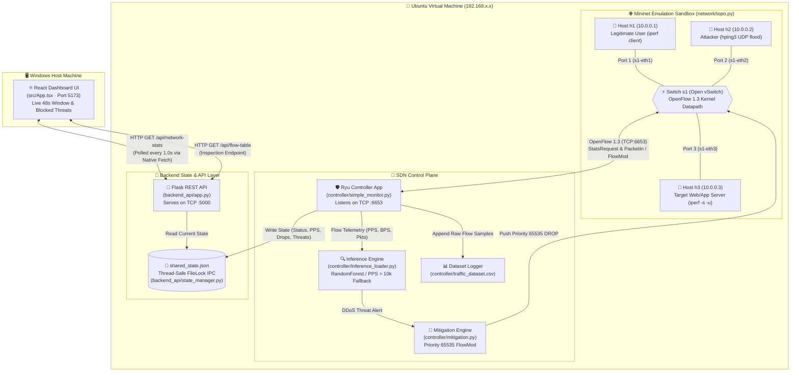
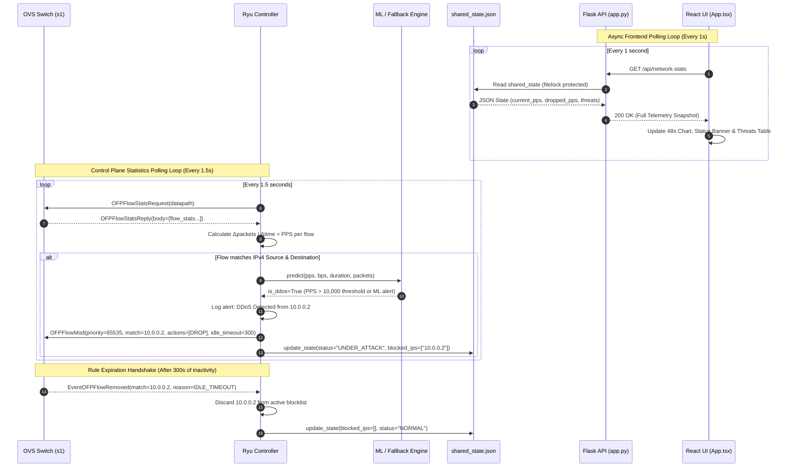
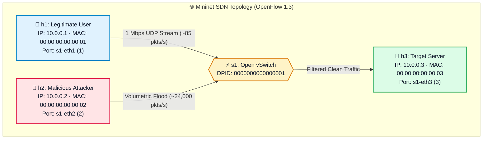
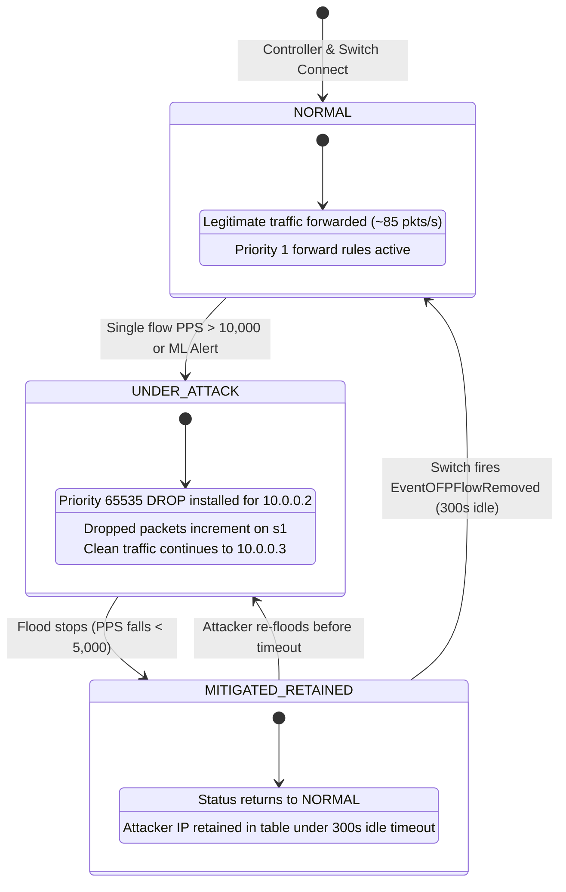
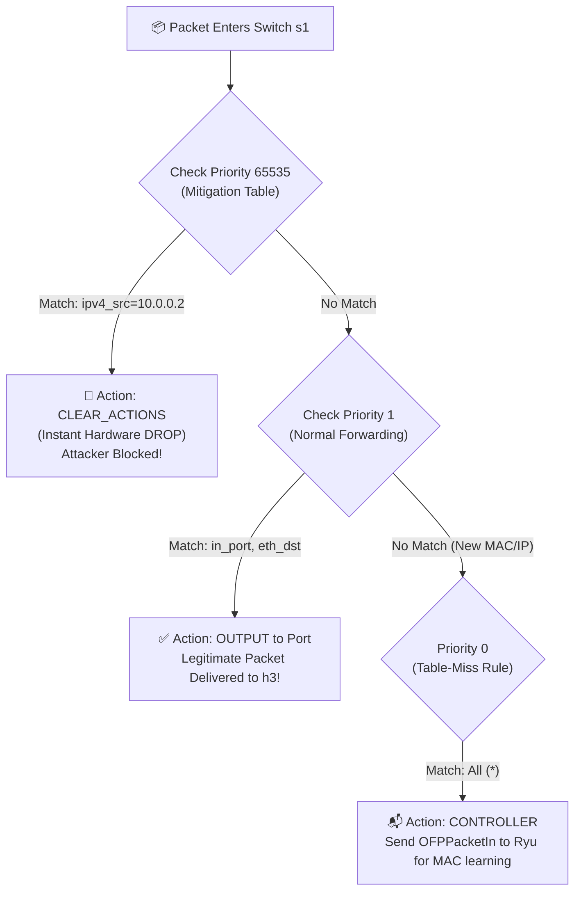

# System Architecture

This document describes the implemented architecture of the SDN DDoS Mitigation project.

## 1. Overview

| Layer | Description |
|---|---|
| **Network (Mininet)** | Emulated environment with 1 switch (s1) and 3 hosts (h1, h2, h3). Handles raw traffic generation. |
| **Control (Ryu)** | OpenFlow 1.3 controller polling switch stats every 1.5s. Manages MAC learning and attack detection. |
| **Detection (ML/Threshold)** | Ryu classifies each IPv4 source/destination flow using `detector.joblib` when present, otherwise the shared 10,000 PPS per-flow fallback. |
| **Backend (Flask + IPC)** | Flask API serving JSON state to the frontend. IPC is via `shared_state.json` modified by Ryu. |
| **Frontend (React)** | Root TypeScript React dashboard polls state every 1s in Live mode; Demo mode is self-contained and does not imply backend connectivity. |

## 2. High-Level Component Diagram

## 3. Attack Detection Sequence Diagram

## 4. Data Flow: Packets to Dashboard

```mermaid
flowchart LR
    Packets["📦 Raw Packets\n(h1 iperf + h2 hping3)"] --> OVS["⚡ OVS Switch (s1)\nKernel Hardware/Software Counters"]
    OVS -->|"OFPFlowStatsReply\n(packet_count, byte_count)"| Ryu["🧠 Ryu Controller\nRate Delta Engine (pps, bps)"]
    Ryu -->|"DDoS Classification & Metrics"| IPC[("📁 shared_state.json\nAtomic FileLock IPC")]
    IPC -->|"Fast In-Memory Read"| Flask["🚀 Flask REST API\nTransforms to UI Schema"]
    Flask -->|"HTTP JSON Payload\n(Ingress, Dropped, Threats)"| Dashboard["⚛️ React Dashboard\nReal-Time 3-Curve Chart"]
```

## 5. Network Topology

*Note: On startup, `net.pingAll()` auto-runs for MAC learning, and iperf server auto-starts on h3. The API uses the switch connection as a readiness signal; it does not independently probe the three hosts.*

## 6. System State Machine

## 7. OpenFlow Rule Priority Hierarchy

## 7. Component Responsibilities

| Component | File Path | Role |
|---|---|---|
| Ryu App | `controller/simple_monitor.py` | Core SDN logic, OF polling every 1.5s, triggering state updates. |
| Mitigation | `controller/mitigation.py` | Installs DROP rules (priority=65535, idle=300s, no hard timeout); OVS flow-removal events clear expired blocked rows. |
| Flask API | `backend_api/app.py` | Exposes REST endpoints serving data from IPC state. |
| State | `backend_api/shared_state.json` | Runtime-generated IPC state shared with Flask under a file lock. |
| React UI | `src/App.tsx` | Visualizes state, handles smooth 48-point charts and threats table. |

*Last Updated: 2026-10-28*
