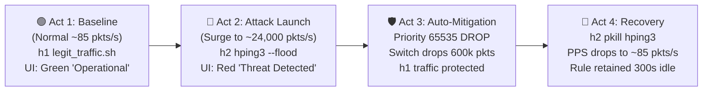
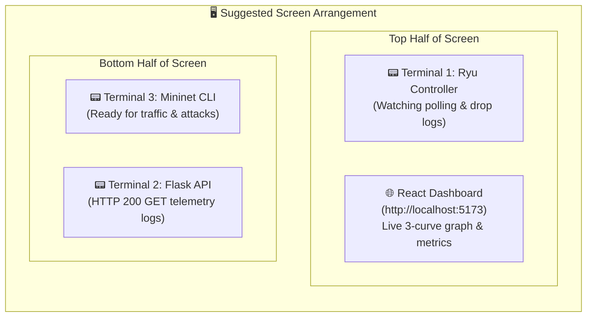

# Demo Script

A structured guide for presenting the SDN DDoS Mitigation project.

## 1. Pre-Demo Setup
Ensure all components are running before presenting.

1. **Terminal 1 (Ryu, Ubuntu VM):**
   ```bash
   source ryu39_env/bin/activate
   ryu-manager controller/simple_monitor.py
   ```
2. **Terminal 2 (Flask, Ubuntu VM):**
   ```bash
   source ryu39_env/bin/activate
   cd backend_api
   python3 app.py
   ```
3. **Terminal 3 (Mininet, Ubuntu VM):**
   ```bash
   sudo mn -c
   sudo python3 network/topo_botnet.py     # 10-host botnet topology
   # (or sudo python3 network/topo.py for 3-host demo)
   ```
4. **Terminal 4 (React Dashboard, Any Machine):**
   ```bash
   npm run dev
   # Open browser at http://171.171.1.253:5173 or http://localhost:5173
   ```

## 2. Presentation Flowchart



## 3. Window Layout

Organize your screen to maximize visibility of system interactions:



```text
+-------------------------+-------------------------+
| [Ryu Terminal]          | [React Dashboard]       |
| Showing stat polling    | Showing live chart      |
| and detection logs      | http://localhost:5173   |
+-------------------------+-------------------------+
| [Mininet CLI]           | [Flask API]             |
| Ready for hping3        | Showing GET requests    |
+-------------------------+-------------------------+
```

## 4. Act 1: Baseline (2 min)
**Action:** Show the dashboard and Mininet CLI. Start legitimate user traffic:
```bash
mininet> h1 bash network/legit_traffic.sh &
```
**Talk Track:** "Welcome to our SDN DDoS defense project. We have an emulated Mininet topology with Open vSwitch s1 and Ryu SDN controller. Notice our dashboard is green ('Network Operating Normally'). Legitimate user h1 is streaming UDP traffic steadily at ~85 packets per second."

## 5. Act 2: Attack Launch (1 min)
**Action:** In Mininet CLI, launch the high-rate UDP flood attack:
```bash
mininet> h2 hping3 --flood --udp -p 80 10.0.0.3 &
```
*(Optionally use `xterm h2` if graphical display forwarding is active).*
**Talk Track:** "I am now launching a volumetric UDP flood attack from rogue node h2 towards our victim server h3 at 10.0.0.3."

## 6. Act 3: Autonomous Defense (1 min)
**Action:** Point to the dashboard changing state in real-time and the Ryu terminal output. Show the installed OpenFlow rule on the switch:
```bash
mininet> sh ovs-ofctl dump-flows s1 -O OpenFlow13
```
**Talk Track:** "Within two seconds, Ryu's flow polling engine detects the PPS threshold breach (>10,000 pkts/s). An OpenFlow Priority 65535 DROP rule is immediately pushed to the switch for source IP 10.0.0.2. Over 600,000 attack packets are discarded directly at the switch port, while legitimate user h1's traffic continues uninterrupted!"

## 7. Act 4: Recovery (1 min)
**Action:** Stop the attack flood in Mininet:
```bash
mininet> h2 pkill -9 hping3
```
**Talk Track:** "Once the attack halts, total ingress falls back to our normal baseline (~85 pkts/s) and the dashboard returns to green. Notice that attacker 10.0.0.2 remains in the Blocked Devices table with a 'RULE RETAINED' badge until the switch's 300-second idle-timeout expires, protecting the server against burst re-offenders."

## 8. Bonus: Flow Table & Per-IP Telemetry Inspection
**Action:** In an Ubuntu terminal or browser, inspect the human-readable flow table:
```bash
curl http://171.171.1.253:5000/api/flow-table
curl http://171.171.1.253:5000/api/network-stats
```
**Talk Track:** "We also built dedicated OpenFlow inspection endpoints that separate ALLOWED flows, BLOCKED flows, and individual per-host statistics (`ipTraffic`). The React dashboard displays this with an inline horizontal stacked bar chart showing exact Passed vs. Blocked ratios per host."

## 9. Interactive Attack Emulation Menu Demo
**Action:** In an Ubuntu terminal, launch the new interactive attack menu:
```bash
sudo bash network/attack_menu.sh
```
**Talk Track:** "Our new attack launchpad allows selecting from 11 emulation options, including volumetric UDP floods, TCP SYN floods, Slowloris HTTP starvation, ICMP echo floods, and dynamic pulsing wave DDoS. Most importantly, Option 7 demonstrates **Same-IP Mixed Traffic**, where nodes h2 and h4 simultaneously emit legitimate streams that pass through and flood attacks that are dropped at line-rate."

## 10. Q&A

**Q: Are you using machine learning?**
A: Yes! The system features an active Tier-1 CIC-DDoS2019 Decision Tree model trained on 207,444 flows across 28 ANOVA features. It achieves 99.99% accuracy with 0.00% false positive rate and sub-millisecond inference (~0.18–0.28 ms SLA per flow).

**Q: How does same-IP mixed traffic work?**
A: Ryu installs flow-granular rules matching the full flow tuple `(eth_type, src_ip, dst_ip, ip_proto, dst_port)`. Benign traffic matches Priority 10 FORWARD rules, while malicious streams matching the attack signature are blocked by Priority 65535 DROP rules without blackholing the entire IP.

**Q: How do the frontend and backend communicate?**
A: Ryu writes to `shared_state.json` securely using a filelock. The Flask API reads this file and serves it to the React app via `GET /api/network-stats` every 1 second. The frontend sums all per-IP rates to ensure 100% mathematical consistency with the KPI cards.

**Q: What triggers mitigation?**
A: Observed flow statistics are evaluated against the ML classifier. Upon detecting an attack profile (volumetric, SYN flood, Slowloris, ICMP, or pulsing), Ryu sends an `OFPFlowMod` message pushing a Priority 65535 DROP rule with an idle timeout of 300 seconds.

*Last Updated: 2026-11-18*
