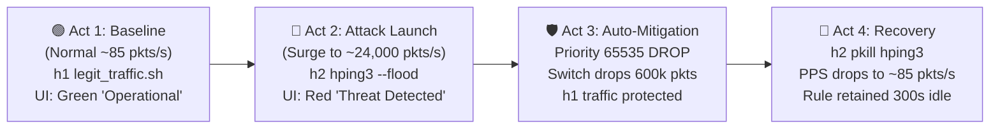
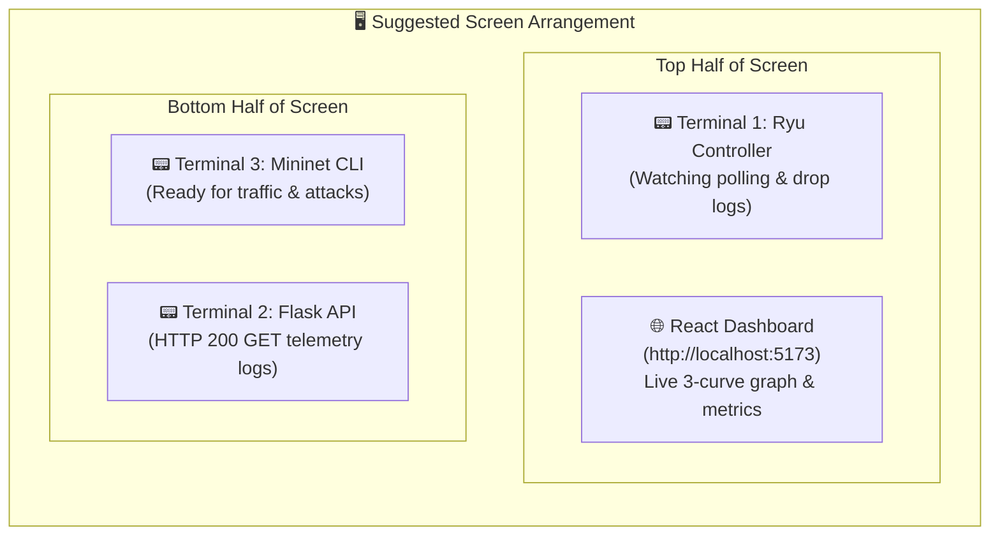

# Demo Script

A structured guide for presenting the SDN DDoS Mitigation project.

## 1. Pre-Demo Setup
Ensure all components are running before presenting.

1. **Terminal 1 (Ryu, Ubuntu VM):**
   ```bash
   source ryu39_env/bin/activate
   ryu-manager controller/simple_monitor.py
   ```
2. **Terminal 2 (Flask, Ubuntu VM):**
   ```bash
   source ryu39_env/bin/activate
   cd backend_api
   python3 app.py
   ```
3. **Terminal 3 (Mininet, Ubuntu VM):**
   ```bash
   sudo mn -c
   sudo python3 network/topo.py
   ```
4. **Terminal 4 (React, Windows Host):**
   ```powershell
   cd "DDoS Mitigation"
   npm run dev
   ```

## 2. Presentation Flowchart



## 3. Window Layout

Organize your screen to maximize visibility of system interactions:



```text
+-------------------------+-------------------------+
| [Ryu Terminal]          | [React Dashboard]       |
| Showing stat polling    | Showing live chart      |
| and detection logs      | http://localhost:5173   |
+-------------------------+-------------------------+
| [Mininet CLI]           | [Flask API]             |
| Ready for hping3        | Showing GET requests    |
+-------------------------+-------------------------+
```

## 4. Act 1: Baseline (2 min)
**Action:** Show the dashboard and Mininet CLI. Start legitimate user traffic:
```bash
mininet> h1 bash network/legit_traffic.sh &
```
**Talk Track:** "Welcome to our SDN DDoS defense project. We have an emulated Mininet topology with Open vSwitch s1 and Ryu SDN controller. Notice our dashboard is green ('Network Operating Normally'). Legitimate user h1 is streaming UDP traffic steadily at ~85 packets per second."

## 5. Act 2: Attack Launch (1 min)
**Action:** In Mininet CLI, launch the high-rate UDP flood attack:
```bash
mininet> h2 hping3 --flood --udp -p 80 10.0.0.3 &
```
*(Optionally use `xterm h2` if graphical display forwarding is active).*
**Talk Track:** "I am now launching a volumetric UDP flood attack from rogue node h2 towards our victim server h3 at 10.0.0.3."

## 6. Act 3: Autonomous Defense (1 min)
**Action:** Point to the dashboard changing state in real-time and the Ryu terminal output. Show the installed OpenFlow rule on the switch:
```bash
mininet> sh ovs-ofctl dump-flows s1 -O OpenFlow13
```
**Talk Track:** "Within two seconds, Ryu's flow polling engine detects the PPS threshold breach (>10,000 pkts/s). An OpenFlow Priority 65535 DROP rule is immediately pushed to the switch for source IP 10.0.0.2. Over 600,000 attack packets are discarded directly at the switch port, while legitimate user h1's traffic continues uninterrupted!"

## 7. Act 4: Recovery (1 min)
**Action:** Stop the attack flood in Mininet:
```bash
mininet> h2 pkill -9 hping3
```
**Talk Track:** "Once the attack halts, total ingress falls back to our normal baseline (~85 pkts/s) and the dashboard returns to green. Notice that attacker 10.0.0.2 remains in the Blocked Devices table with a 'RULE RETAINED' badge until the switch's 300-second idle-timeout expires, protecting the server against burst re-offenders."

## 8. Bonus: Flow Table Inspection
**Action:** In an Ubuntu terminal or browser, inspect the human-readable flow table:
```bash
curl http://192.168.8.147:5000/api/flow-table
```
**Talk Track:** "We also built a dedicated OpenFlow inspection endpoint that separates ALLOWED flows, BLOCKED flows, and the TABLE-MISS rule for academic auditability."

## 9. Q&A

**Q: Are you using machine learning?**
A: We have designed an ML pipeline with a RandomForestClassifier. Currently, the controller uses a robust fallback threshold (PPS > 10,000) while the model `detector.joblib` completes training.

**Q: How do the frontend and backend communicate?**
A: Ryu writes to a `shared_state.json` file securely using a filelock. The Flask API reads this file and serves it to the React app via a single REST endpoint `/api/network-stats` every 1 second.

**Q: Why 1.5 seconds for polling?**
A: It offers a balance between rapid detection and keeping switch control plane overhead low.

**Q: How does the switch know to drop traffic?**
A: Ryu installs an `OFPFlowMod` rule with priority 65535, matching the attacker's IP and instructing the switch to DROP.

**Q: Is the dashboard real-time?**
A: Yes, it fetches state every 1 second using native `fetch` and maintains a 48-second rolling window.

**Q: What version of Python is required?**
A: Python 3.9 in the `ryu39_env` virtual environment for Ryu compatibility.

**Q: Are cross-origin requests handled?**
A: Yes, Flask is configured with `CORS(origins="*")` to permit the React dev server to communicate easily.

**Q: What triggers a recovery?**
A: The status returns to operational when traffic falls below 5,000 PPS; the blocked record stays until the switch confirms that its idle-timeout removed the rule.

## 9. Backup Plans
- **Mininet crashes:** `sudo mn -c` to clean up and restart.
- **Dashboard fails:** Reload the page; verify `.env` IP matches the Ubuntu VM.
- **Ryu fails:** Restart the `simple_monitor.py` script; verify `ryu39_env` is active.
- **ML fails:** The code has a fallback to the PPS threshold built-in natively.

*Last Updated: 2026-10-09*
