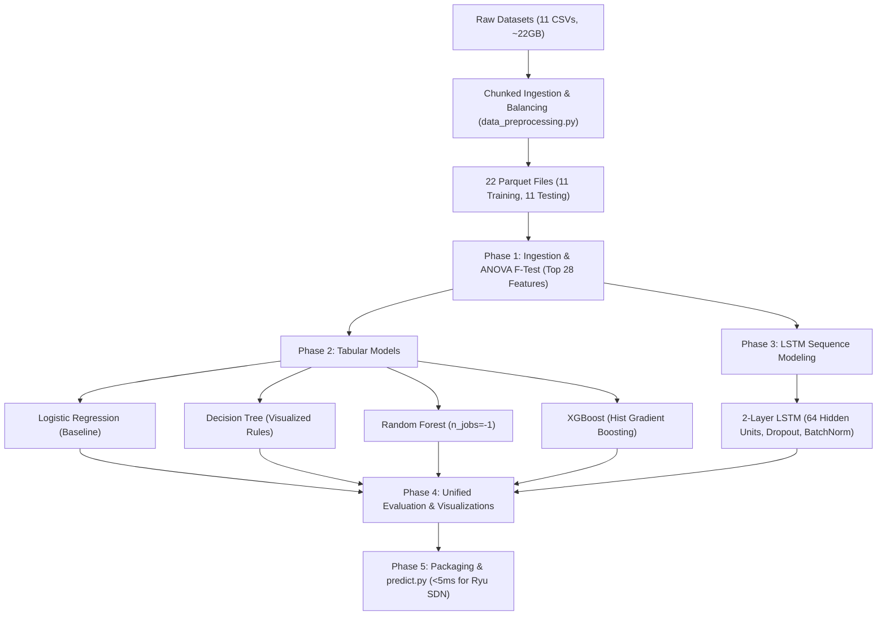

# SDN-Based DDoS Detection & Mitigation: Master ML Pipeline Execution Plan

## 1. Project Overview & System Objectives
This project implements an end-to-end Machine Learning pipeline tailored for real-time Software-Defined Networking (SDN) DDoS detection and mitigation using the CIC-DDoS2019 dataset and integration with the Ryu SDN Controller.

### Target Hardware Constraints & Optimization Profile
- **System Memory:** 16 GB DDR4/DDR5 RAM
  - *Optimization Strategy:* Chunked streaming (50k rows/batch), data downcasting (`float64` $\to$ `float32`, `int64` $\to$ `int32` saving 50% memory), aggressive garbage collection (`gc.collect()`), and Snappy-compressed Parquet I/O.
- **GPU Accelerator:** NVIDIA GeForce RTX 5050 (8 GB GDDR6/7 VRAM, Blackwell Architecture)
  - *Optimization Strategy:* TensorFlow / PyTorch dynamic memory growth (`tf.config.experimental.set_memory_growth`), mini-batching (128/256), and histogram-based XGBoost (`tree_method='hist'`).
- **SDN Latency SLA:** $< 5.0$ milliseconds per flow prediction for zero-delay OpenFlow packet-in/flow-mod mitigation.

---

## 2. Phase-by-Phase Architecture



---

## 3. Detailed Phase Breakdown

### Phase 1: Local Data Ingestion & Preprocessing
1. **Source Data Handling (`data_preprocessing.py`):**
   - Ingest 11 DDoS attack categories from CIC-DDoS2019: `DNS`, `LDAP`, `MSSQL`, `NTP`, `NetBIOS`, `SNMP`, `SSDP`, `UDP`, `SYN`, `TFTP`, and `UDPLag`.
   - Strip whitespace in column headers, drop non-predictive metadata (`Unnamed: 0`, `Flow ID`, `Source IP`, `Destination IP`, `Timestamp`, `SimillarHTTP`).
   - Clean infinite values and impute missing data using training column medians.
   - Balance `BENIGN` and `Attack` classes to prevent skewed accuracy.
   - Deduplicate network flows and split 70% training / 30% testing.
   - Export 22 Parquet files (`<Category>_training.parquet` and `<Category>_testing.parquet`).

2. **Ingestion & Feature Selection (`pipeline.py`):**
   - Concatenate all 11 `_training.parquet` files into a unified training dataframe and all 11 `_testing.parquet` files into a unified testing dataframe.
   - Apply `StandardScaler` fitted **only** on training features.
   - Implement ANOVA F-test (`SelectKBest(score_func=f_classif, k=28)`) fitted **only** on training features to reduce the 81 network flow features to the top 28 most discriminative features.
   - Save `scaler.joblib`, `anova_selector.joblib`, and `selected_features.json`.

---

### Phase 2: Tabular Model Training
Train four tabular architectures using CPU multi-threading:
1. **Logistic Regression:**
   - Configuration: `solver='lbfgs'`, `max_iter=1000`, `n_jobs=-1`.
   - Role: High-throughput, linear baseline with sub-millisecond latency.
2. **Decision Tree Classifier:**
   - Configuration: `max_depth=8`, `min_samples_split=20`, `random_state=42`.
   - Deliverables: Export human-readable text rules (`tree_rules.txt`) and high-resolution diagram (`tree_rules.png`).
3. **Random Forest Classifier:**
   - Configuration: `n_estimators=100`, `max_depth=16`, `n_jobs=-1`, `random_state=42`.
   - Role: High-accuracy ensemble robust against noisy network flow metrics.
4. **XGBoost Classifier:**
   - Configuration: `tree_method='hist'`, `n_estimators=100`, `learning_rate=0.1`, `n_jobs=-1`.
   - Role: State-of-the-art gradient boosted decision trees for tabular telemetry.

---

### Phase 3: Sequence Modeling (LSTM)
1. **Temporal Sequence Reshaping:**
   - Vectorized sliding-window transformation converting 2D flow matrices `(N, 28)` into 3D sequential tensors `(N - time_steps + 1, time_steps, 28)` with `time_steps=10`.
2. **Deep Architecture:**
   - Input layer: `(10, 28)`
   - Layer 1: `LSTM(64, return_sequences=True)`
   - Regularization 1: `Dropout(0.2)` + `BatchNormalization()`
   - Layer 2: `LSTM(64, return_sequences=False)`
   - Regularization 2: `Dropout(0.2)` + `BatchNormalization()`
   - Dense Head: `Dense(32, activation='relu')` $\to$ `Dense(1, activation='sigmoid')`
3. **Hardware Execution & Safety:**
   - Memory growth enabled on RTX 5050 (8GB VRAM).
   - Batch size: 128 / 256 to ensure zero out-of-memory errors.
   - Export format: `lstm_ddos_model.keras` and `lstm_ddos_model.h5`.

---

### Phase 4: Evaluation & Visualizations
1. **Unified Performance Metrics:**
   - Evaluated on the testing set across all five models (Logistic Regression, Decision Tree, Random Forest, XGBoost, and LSTM):
     - **Accuracy:** Overall proportion of correct classifications.
     - **Precision:** Positive predictive value ($\frac{TP}{TP + FP}$).
     - **Recall:** Sensitivity / True Positive Rate ($\frac{TP}{TP + FN}$).
     - **Macro F1-Score:** Unweighted mean of class F1-scores.
     - **Weighted F1-Score:** Support-weighted average F1-score.
     - **False Positive Rate (FPR):** $\frac{FP}{FP + TN}$ (crucial to prevent dropping legitimate benign traffic in SDN).
2. **Prediction Latency Benchmarking:**
   - High-precision latency profiling (`time.perf_counter()`) running 500 single-packet iterations.
   - Expressed in **milliseconds per packet/flow**, establishing whether models pass the $<5.0$ ms SDN controller SLA.
3. **Blinded Zero-Day Generalization Test:**
   - Dedicated evaluation where models are tested on an attack category completely blinded during training (e.g., NTP or TFTP held out) to assess zero-day defense capabilities.

4. **Visualizations (Export as `.png` at 300 DPI):**
   - **`visualizations/confusion_matrices_per_attack.png`:**
     - High-resolution bar breakdown demonstrating individual classification accuracy across each of the 11 CIC-DDoS2019 attack categories (DNS, LDAP, MSSQL, NTP, NetBIOS, SNMP, SSDP, UDP, SYN, TFTP, UDPLag).
   - **`visualizations/confusion_matrices_all_models.png`:**
     - Multi-panel $2 \times 3$ grid displaying annotated confusion matrices for each of the five models (showing True Benign, False Attack, False Benign, True Attack).
   - **`visualizations/combined_roc_pr_curves.png`:**
     - Dual-panel comparative diagnostic plot:
       - **Left:** Receiver Operating Characteristic (ROC) curves with computed Area Under Curve (ROC-AUC) for all 5 models against a random classifier baseline.
       - **Right:** Precision-Recall (PR) curves with Average Precision (AP) scores to evaluate precision stability under class imbalances.
   - **`visualizations/accuracy_vs_latency.png`:**
     - Dual-axis bar chart directly contrasting **Detection Accuracy (%)** on the primary Y-axis against **Prediction Latency (ms per packet)** on the secondary Y-axis across all five models, highlighting the optimal model for production SDN deployment.

---

### Phase 5: Packaging & Deliverables
1. **Exported Artifacts (`exported_models/`):**
   - Tabular models exported via `joblib`: `logistic_regression.joblib`, `decision_tree.joblib`, `random_forest.joblib`, `xgboost.joblib`, and `best_sdn_model.joblib`.
   - Trained LSTM model: `lstm_ddos_model.keras` and `lstm_ddos_model.h5`.
   - Feature engineering pipeline: `scaler.joblib`, `anova_selector.joblib`, and `selected_features.json`.
   - Comprehensive metric tables: `evaluation_metrics.csv` and `generalization_results.csv`.
2. **Standalone `predict.py` Module:**
   - Single entrypoint: `predict_packet(packet_data)`.
   - Loads the best-performing model, scaler, and ANOVA selector into memory.
   - Optimized inference path returning predictions in **under 5 milliseconds**.
   - Structured output format:
     ```python
     {
         "is_ddos": True,
         "label": "ATTACK",
         "confidence": 0.9982,
         "latency_ms": 0.384,
         "action": "DROP"  # or "FORWARD"
     }
     ```
   - Direct drop-in integration template for Ryu SDN Controller event handlers.

---

## 4. Execution Roadmap & Milestones

| Step | Script / Module | Objective | Estimated Time | Deliverables |
|---|---|---|---|---|
| **Step 1** | `data_preprocessing.py` | Generate 22 balanced Parquet files from 11 raw CSVs | ~5-10 min (chunked) | 22 `.parquet` files in `parquet_data/` |
| **Step 2** | `pipeline.py` (Phase 1) | Ingest Parquet & fit ANOVA F-test (top 28 features) | ~30 sec | `scaler.joblib`, `anova_selector.joblib` |
| **Step 3** | `pipeline.py` (Phase 2) | Train Logistic Regression, Decision Tree, Random Forest, XGBoost | ~1-2 min | Tabular `.joblib` models, `tree_rules.png` |
| **Step 4** | `pipeline.py` (Phase 3) | Reshape sequences & train 2-layer LSTM on RTX 5050 | ~2-4 min | `lstm_ddos_model.keras`, `.h5` |
| **Step 5** | `pipeline.py` (Phase 4) | Run evaluation, latency test, blinded test & export PNGs | ~1-2 min | 4 high-res `.png` plots, metrics CSVs |
| **Step 6** | `predict.py` (Phase 5) | Validate real-time SDN packet inference SLA (< 5ms) | ~10 sec | Production-ready `predict_packet()` |
